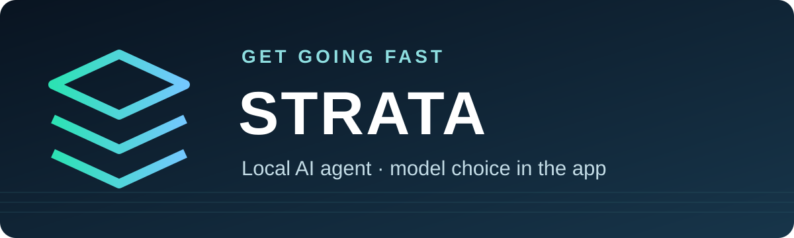

# GGF Strata Local Agent



**Want a quick install and the GGF GUI with more models? Visit [getgoingfast.pro/tools/strata](https://getgoingfast.pro/tools/strata).**

**Get Going Fast** adaptation of [Strata](https://github.com/Niko1221/Strata) for a local Windows AI agent. The app offers Qwen3.6, Qwen3.8, and DeepSeek V4.1 Flash model families with selectable quantizations. It shows hardware guidance and downloads the selected model and compatible inference engine only after confirmation in the running app. With no model installed, Settings opens to DARLA's setup guide. Agent tools request approval for changes.

This is the **source repository**, not the member quick installer. It contains the GGF launch controls, modified UI source overlay, ready-built UI, and artwork. It contains no model weights, installed engine, private settings, or official Strata application binary. The separate member installer is available through Get Going Fast.

## Manual installation on Windows

Use **Command Prompt**. Install [Git](https://git-scm.com/downloads/win) and [7-Zip](https://www.7-zip.org/) first. The commands below assume `7z.exe` is on `PATH`; otherwise use its full path. Choose a writable folder with enough space for the models you plan to use.

To install 7-Zip with Windows Package Manager, run:

```bat
winget install 7z
```

If `7z` is not recognized afterward, use `"C:\Program Files\7-Zip\7z.exe"` in place of `7z` in the extraction command below (or use your actual 7-Zip installation path).

1. Clone this repository:

   ```bat
   git clone https://codeberg.org/Cognibuild/GGF-Strata.git
   cd GGF-Strata
   ```

   GitHub alternative: `git clone https://github.com/gjnave/GGF-Strata.git`.

2. Download the pinned official Windows app from [Strata v0.2.7](https://github.com/Niko1221/Strata/releases/tag/v0.2.7):

   ```bat
   curl.exe --fail --location --output Strata-0.2.7-windows-x64-setup.exe https://github.com/Niko1221/Strata/releases/download/v0.2.7/Strata-0.2.7-windows-x64-setup.exe
   certutil -hashfile Strata-0.2.7-windows-x64-setup.exe SHA256
   ```

   Confirm the SHA-256 is **`b6b078cfd1939a8375eadf9181952d7c1cb267061a3e3428f35cd3b9d1b60da3`**. Stop if it differs.

3. Extract the portable application and apply the GGF interface:

   ```bat
   7z x Strata-0.2.7-windows-x64-setup.exe -oStrata\app
   xcopy Strata\ui\* Strata\app\host\dist\ /E /I /Y
   ```

   This extraction does not register a Windows installation. `Strata/ui-source/` records the modified UI source files; the prebuilt files in `Strata/ui/` are what the app serves.

4. Double-click **`run.bat`**. It starts this folder's server at `http://127.0.0.1:8798/` and opens the app. In Settings, follow DARLA to choose a model family and quantization. Review the app's disk and memory estimate before confirming the download. No model downloads during clone or startup.

   If port 8798 is already used by another Strata installation, run these commands from the repository folder in Command Prompt:

   ```bat
   set STRATA_PORT=8799
   run.bat
   ```

   This copy opens at `http://127.0.0.1:8799/`. The port setting applies only to that Command Prompt session; repeat it when starting from a new Command Prompt.

5. Double-click **`stop.bat`** to unload the model and stop this server. Finish or cancel active chats and downloads first. Both BAT files show their result until you press a key.

   If you started on port 8799, stop it from the repository folder in Command Prompt using the same port:

   ```bat
   set STRATA_PORT=8799
   stop.bat
   ```

   Closing the browser or launcher window does **not** stop the server. Use `stop.bat` from the installation folder that started it.

Keep the `Strata/` folder beside `run.bat` and `stop.bat`. You may move the whole folder before starting it; its data paths are relative to the BAT files. Do not run two copies on port 8798 at once.

## Source and licensing

The UI overlay is under `Strata/ui-source/`, the built interface under `Strata/ui/`, and the GGF host control under `Strata/member.py`. The upstream Strata UI license is preserved in [`Strata/ui-LICENSE.txt`](Strata/ui-LICENSE.txt). The official app and model downloads retain their respective upstream licenses. The GGF branding artwork is for this project.

The [Codeberg](https://codeberg.org/Cognibuild/GGF-Strata) and [GitHub](https://github.com/gjnave/GGF-Strata) repositories mirror this source-only release. The member quick installer remains separate.
